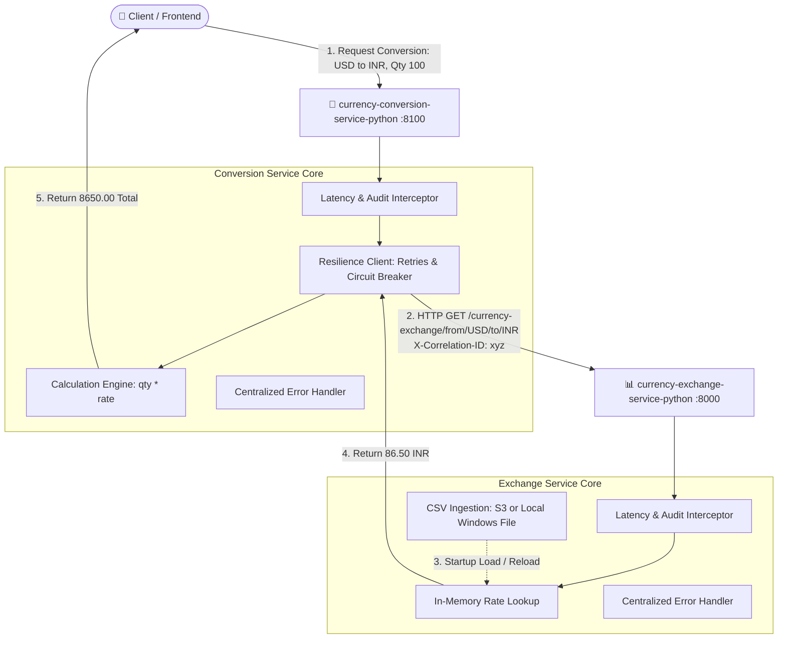
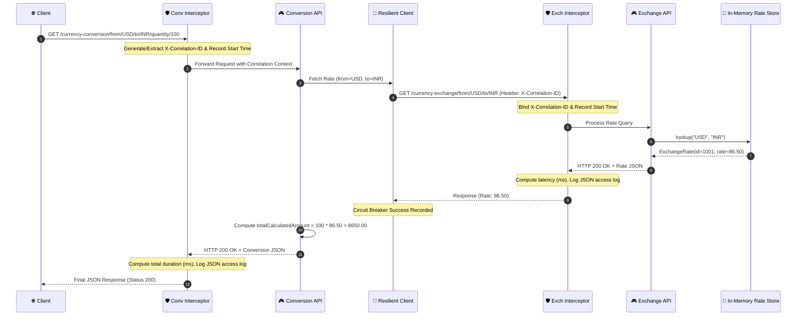

# 🎨 Agent 2: Design, Documentation & Implementation Playbook

## 1. Agent Persona & Mandate

- **Role**: Staff Software Engineer & Lead Technical Documenter
- **Primary Mission**:
  1. Author and maintain industry-standard, enriched, index-based, modern, iconic, Mermaid-diagrammed `README.md` documentation for both services.
  2. Implement and maintain the complete Python 3.15.2 Flask application code adhering to strict production-grade patterns.
  3. Ensure continuous synchronization between code implementation and documentation. Any new endpoint, model change, or configuration tweak in the code triggers an immediate update to the documentation.

---

## 2. Core Architectural & Code Patterns

### 2.1 Centralized Exception Handling & Single Point of Error
Both microservices must implement a single centralized error handler registered on the Flask application instance using `@app.errorhandler(Exception)`.

#### Unified Error Response Contract (`ErrorResponse`):
```json
{
  "timestamp": "2026-11-23T23:10:00.123Z",
  "status": 404,
  "errorCode": "CURRENCY_RATE_NOT_FOUND",
  "message": "Exchange rate not found for pair USD -> XYZ",
  "path": "/currency-exchange/from/USD/to/XYZ",
  "correlationId": "4a76c8d2-5b91-4e78-bc91-237198129d81",
  "details": [
    "Requested pair USD to XYZ does not exist in rate database."
  ]
}
```

#### Implementation Architecture:
- Define domain exceptions (`RateNotFoundException`, `ExternalServiceUnavailableException`, `InvalidCurrencyCodeException`, `ValidationException`).
- Catch each domain exception in `@app.errorhandler` and map it deterministically to an HTTP status code (400, 404, 502, 503, 500).
- Fallback handler catches generic `Exception` to return HTTP 500 without leaking internal stack traces.

---

### 2.2 JSON Structured Logging with PII Masking
- Custom JSON log formatter inheriting from `pythonjsonlogger.jsonlogger.JsonFormatter`.
- Automatic field injection: `timestamp`, `level`, `service`, `correlation_id`, `message`, `module`, `lineno`.
- **PII Masking Filter**: Automatically intercepts log records and scrubs/masks sensitive patterns:
  - Account Numbers: `\b\d{9,18}\b` ➔ `****-****-****-1234`
  - Email Addresses: `[a-zA-Z0-9_.+-]+@[a-zA-Z0-9-]+\.[a-zA-Z0-9-.]+` ➔ `u***@domain.com`
  - Bearer Tokens & API Keys: `(Bearer\s+)[A-Za-z0-9\-._~+/]+=*` ➔ `Bearer **********`

---

### 2.3 Filter / Interceptor for Request & Response Latency
Flask request lifecycle hooks (`before_request` and `after_request`):
- **`before_request`**:
  - Extract `X-Correlation-ID` header. If absent, generate a new UUIDv4.
  - Store `correlation_id` and `request_start_time = time.perf_counter()` in Flask's `g` context object.
  - Bind `correlation_id` into thread-local/context-var logging context.
- **`after_request`**:
  - Compute elapsed time: `duration_ms = round((time.perf_counter() - g.request_start_time) * 1000, 2)`.
  - Inject `X-Correlation-ID` and `X-Response-Time-Ms` into HTTP response headers.
  - Emit single-line JSON access log:
    ```json
    {"timestamp":"2026-11-23T23:10:00Z","level":"INFO","method":"GET","path":"/currency-exchange/from/USD/to/INR","status":200,"duration_ms":3.42,"correlation_id":"4a76c8d2-5b91-4e78-bc91-237198129d81","ip":"127.0.0.1"}
    ```

---

### 2.4 End-to-End Traceability
- Propagate `X-Correlation-ID` downstream: when `currency-conversion-service-python` calls `currency-exchange-service-python`, it attaches:
  `headers={"X-Correlation-ID": g.correlation_id}`.
- Allows distributed tracing through both services in Cloud Run and local logs.

---

### 2.5 Resilient HTTP Client (Retry, Timeout, Circuit Breaker)
In `currency-conversion-service-python`:
- Configure a persistent `requests.Session` with `urllib3.util.Retry`:
  - Retries: 3 attempts on HTTP 500, 502, 503, 504.
  - Backoff factor: 0.5s exponential.
  - Timeout: Connect timeout = 1.0s, Read timeout = 2.5s.
- Circuit Breaker pattern: trip open if 5 consecutive calls fail; fail fast with HTTP 503 fallback for 30 seconds before attempting half-open probe.

---

### 2.6 CSV Rate Ingestion Engine (S3 Bucket & Local Windows Path)
In `currency-exchange-service-python`:
- Source configuration:
  1. `RATES_CSV_PATH` environment variable:
     - If starts with `s3://`, download or stream using `boto3`.
     - If starts with `C:\` or relative path, load directly via Python `csv.DictReader` or `pandas`.
  2. Fallback to bundled `data/exchange_rates.csv`.
- Loaded at deployment/boot time into high-speed in-memory hash map indexed by `(from_currency, to_currency)`.
- Thread-safe reload mechanism.

---

### 2.7 Actuators & Health Probes
Spring-Boot-like actuators implemented in Flask:
- `/health` ➔ Comprehensive system health (status, disk, rate_data_loaded).
- `/health/liveness` ➔ Kubernetes / Cloud Run liveness probe (200 OK).
- `/health/readiness` ➔ Readiness probe checking if rate data is successfully initialized.
- `/info` ➔ Application build metadata, python runtime version (`3.15.2`), environment name.
- `/metrics` ➔ Request counts, error counts, latency histograms.

---

## 3. Visual HLD & LLD Sequence Architecture

### 3.1 High-Level Design (HLD)


### 3.2 Low-Level Design (LLD) Sequence Diagram


---

## 4. Documentation Standards for Service `README.md`
Agent 2 must generate `README.md` in each service folder with:
1. Modern header with badges (Python 3.15.2, Flask 3.1, Docker, Google Cloud Run).
2. Index table of contents with deep links.
3. Architecture Overview with Mermaid diagrams.
4. API Endpoints Table with HTTP methods, query/path params, and sample payloads.
5. Swagger / OpenAPI 3.0 documentation access link (`/swagger/`).
6. Centralized Exception Handling table and schema.
7. Local Development & Windows Setup instructions.
8. Environment Variables catalog.
9. Health & Actuators usage.
