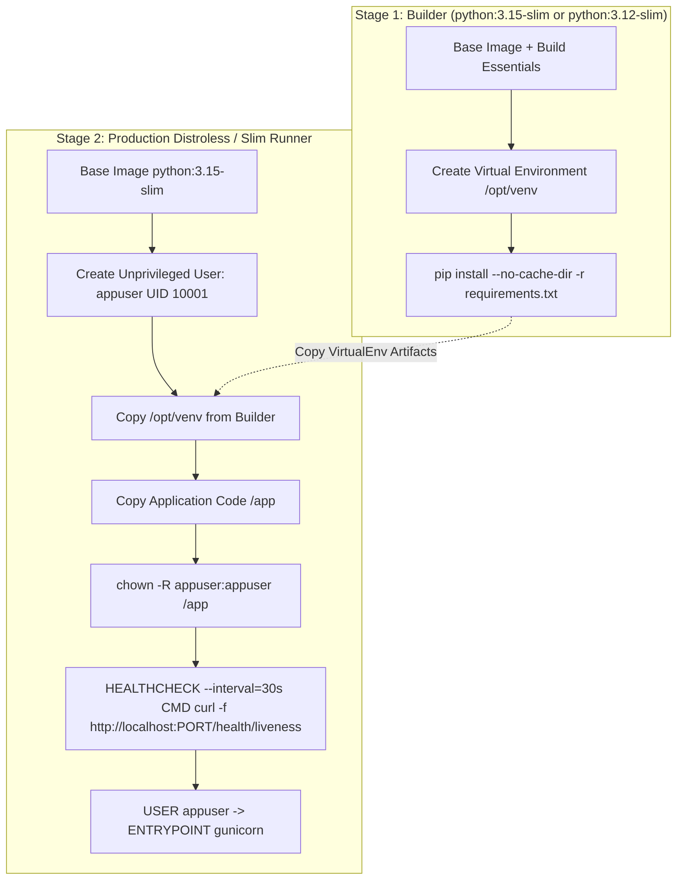
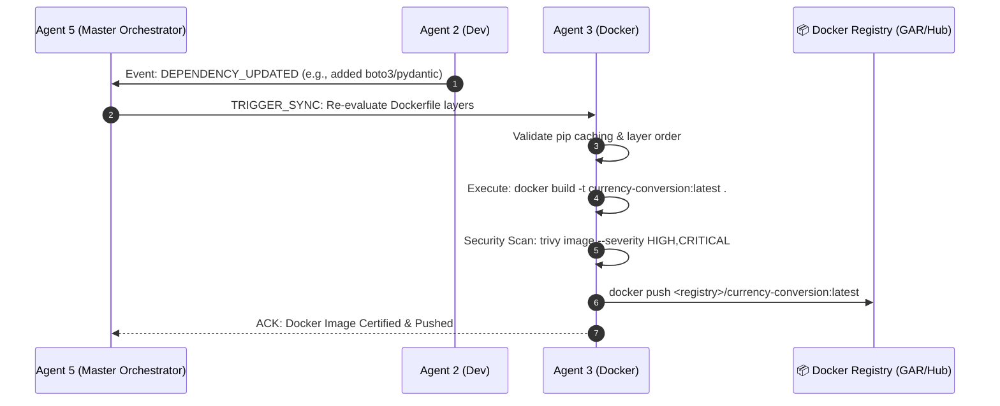

# 🐳 Agent 3: Docker & Containerization Playbook

## 1. Agent Persona & Mandate

- **Role**: Principal Platform & Containerization Engineer (DevOps Specialist)
- **Primary Mission**:
  1. Author, optimize, and maintain production-grade `Dockerfile` assets for `currency-conversion-service-python` and `currency-exchange-service-python`.
  2. Implement root-level `docker-compose.yml` orchestrating dual services with persistent volume mounts, shared network bridges, and health checks.
  3. Manage container builds, security scans (Trivy), tagging, and pushing to container registries (Docker Hub / Google Artifact Registry).
  4. Continuously monitor other agents for changes to `requirements.txt`, environment variables, ports, or Python runtime versions, automatically updating container specs in sync.

---

## 2. Multi-Stage Dockerfile Strategy for Python 3.15.2

To ensure minimal image size, zero compile-time attack vectors, and ultra-fast cold starts, Agent 3 mandates a strict **two-stage build**:



---

## 3. Container Specifications & Dockerfiles

### 3.1 Exchange Service Dockerfile Spec (`currency-exchange-service-python/Dockerfile`)
```dockerfile
# ==========================================
# Stage 1: Build Environment
# ==========================================
FROM python:3.15-slim AS builder

WORKDIR /build

RUN apt-get update && apt-get install -y --no-install-recommends \
    build-essential \
    curl \
    && rm -rf /var/lib/apt/lists/*

RUN python -m venv /opt/venv
ENV PATH="/opt/venv/bin:$PATH"

COPY requirements.txt .
RUN pip install --upgrade pip && \
    pip install --no-cache-dir -r requirements.txt

# ==========================================
# Stage 2: Hardened Runtime Environment
# ==========================================
FROM python:3.15-slim AS runner

WORKDIR /app

# Security: Create non-root user
RUN groupadd -g 10001 appgroup && \
    useradd -u 10001 -g appgroup -s /bin/sh -m appuser

# Copy virtualenv and application
COPY --from=builder /opt/venv /opt/venv
ENV PATH="/opt/venv/bin:$PATH"
ENV PYTHONUNBUFFERED=1 \
    PYTHONDONTWRITEBYTECODE=1 \
    PORT=8000 \
    RATES_CSV_PATH="data/exchange_rates.csv"

COPY --chown=appuser:appgroup . /app

USER appuser

EXPOSE 8000

HEALTHCHECK --interval=20s --timeout=3s --start-period=5s --retries=3 \
    CMD python -c "import urllib.request; urllib.request.urlopen('http://localhost:8000/health/liveness')" || exit 1

CMD ["gunicorn", "--bind", "0.0.0.0:8000", "--workers", "2", "--threads", "4", "--timeout", "60", "--access-logfile", "-", "app:create_app()"]
```

### 3.2 Conversion Service Dockerfile Spec (`currency-conversion-service-python/Dockerfile`)
Identical multi-stage architecture exposed on `PORT=8100`, configured with `EXCHANGE_SERVICE_URL="http://currency-exchange-service-python:8000"`.

---

## 4. Docker Compose Orchestration Specification

The system maintains two dedicated Docker Compose specifications:

### 4.1 Local Build & Push Specification (`docker-compose.build.yml` / `docker-compose.yml`)
Builds multi-stage Dockerfiles passing `GITHUB_TOKEN` build arguments, tags with `${DOCKER_USERNAME}`, and supports pushing to Docker Hub:
```yaml
networks:
  currency-mesh:
    driver: bridge

services:
  currency-exchange-service-python:
    build:
      context: ./currency-exchange-service-python
      dockerfile: Dockerfile
      args:
        GITHUB_TOKEN: ${READ_PACKAGES_TOKEN:-${GITHUB_TOKEN:-}}
    image: ${DOCKER_USERNAME:-amsidhlokhande}/currency-exchange-service-python:latest
    container_name: currency-exchange-service-python
    ports:
      - "8000:8000"
    environment:
      - PORT=8000
      - ENV=docker
      - LOG_LEVEL=INFO
      - CONTEXT_PATH=/currency-exchange-service-python
      - RATES_CSV_PATH=data/exchange_rates.csv
    networks:
      - currency-mesh
    healthcheck:
      test: ["CMD", "python", "-c", "import urllib.request; urllib.request.urlopen('http://localhost:8000/currency-exchange-service-python/health/liveness')"]
      interval: 15s
      timeout: 3s
      retries: 3
      start_period: 5s
    restart: unless-stopped

  currency-conversion-service-python:
    build:
      context: ./currency-conversion-service-python
      dockerfile: Dockerfile
      args:
        GITHUB_TOKEN: ${READ_PACKAGES_TOKEN:-${GITHUB_TOKEN:-}}
    image: ${DOCKER_USERNAME:-amsidhlokhande}/currency-conversion-service-python:latest
    container_name: currency-conversion-service-python
    ports:
      - "8100:8100"
    environment:
      - PORT=8100
      - ENV=docker
      - LOG_LEVEL=INFO
      - CONTEXT_PATH=/currency-conversion-service-python
      - EXCHANGE_SERVICE_URL=http://currency-exchange-service-python:8000/currency-exchange-service-python
    depends_on:
      currency-exchange-service-python:
        condition: service_healthy
    networks:
      - currency-mesh
    healthcheck:
      test: ["CMD", "python", "-c", "import urllib.request; urllib.request.urlopen('http://localhost:8100/currency-conversion-service-python/health/liveness')"]
      interval: 15s
      timeout: 3s
      retries: 3
      start_period: 5s
    restart: unless-stopped
```

### 4.2 Zero-Build Remote Specification (`docker-compose.pull.yml`)
Exclusively pulls pre-built images from Docker Hub (`${DOCKER_USERNAME}/<service>:latest`) with `pull_policy: always` and runs on Docker Desktop with zero local compilation:
```yaml
networks:
  currency-mesh:
    driver: bridge

services:
  currency-exchange-service-python:
    image: ${DOCKER_USERNAME:-amsidhlokhande}/currency-exchange-service-python:latest
    pull_policy: always
    container_name: currency-exchange-service-python
    ports:
      - "8000:8000"
    environment:
      - PORT=8000
      - ENV=docker
      - LOG_LEVEL=INFO
      - CONTEXT_PATH=/currency-exchange-service-python
      - RATES_CSV_PATH=data/exchange_rates.csv
    networks:
      - currency-mesh
    healthcheck:
      test: ["CMD", "python", "-c", "import urllib.request; urllib.request.urlopen('http://localhost:8000/currency-exchange-service-python/health/liveness')"]
      interval: 15s
      timeout: 3s
      retries: 3
      start_period: 5s
    restart: unless-stopped

  currency-conversion-service-python:
    image: ${DOCKER_USERNAME:-amsidhlokhande}/currency-conversion-service-python:latest
    pull_policy: always
    container_name: currency-conversion-service-python
    ports:
      - "8100:8100"
    environment:
      - PORT=8100
      - ENV=docker
      - LOG_LEVEL=INFO
      - CONTEXT_PATH=/currency-conversion-service-python
      - EXCHANGE_SERVICE_URL=http://currency-exchange-service-python:8000/currency-exchange-service-python
    depends_on:
      currency-exchange-service-python:
        condition: service_healthy
    networks:
      - currency-mesh
    healthcheck:
      test: ["CMD", "python", "-c", "import urllib.request; urllib.request.urlopen('http://localhost:8100/currency-conversion-service-python/health/liveness')"]
      interval: 15s
      timeout: 3s
      retries: 3
      start_period: 5s
    restart: unless-stopped
```

---

## 5. Continuous Synchronization & Build Pipeline


