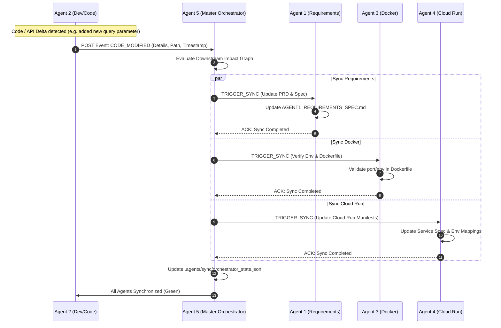

# 🎛️ Agent 5: Master Orchestrator Playbook & Coordination Engine

## 1. System Vision & Orchestration Objective

The **Master Orchestrator (Agent 5)** serves as the supreme governance authority across the multi-agent system. It orchestrates, synchronizes, and monitors all activities of **Agent 1 (Requirements)**, **Agent 2 (Design & Dev)**, **Agent 3 (Docker)**, and **Agent 4 (Cloud Run)**.

### Core Objectives:
1. **Dynamic Execution Modes**: Support both **independent parallel execution** (when tasks have no mutual dependencies) and **strict sequential pipelines** (for contract enforcement and quality gating).
2. **Two-Way Synchronization**: When any agent makes changes (e.g. Agent 2 updates an endpoint model), Agent 5 immediately identifies downstream impacts, alerts the affected agents, and directs them to update their artifacts in lockstep.
3. **Zero Architectural Drift**: Ensure that requirements in PRDs, OpenAPI specifications, documentation, Docker configurations, and Google Cloud Run deployment manifests are 100% congruent.
4. **Auditability & Traceability**: Persist state, events, and audit logs inside `.agents/sync/orchestrator_state.json`.

---

## 2. Multi-Agent Execution Matrix & State Machine

```mermaid
stateDiagram-v2
    [*] --> Phase0_Bootstrap

    state Phase0_Bootstrap {
        [*] --> InitializeEventBus
        InitializeEventBus --> ValidateAgentReadiness
        ValidateAgentReadiness --> BaselineStateSnapshot
        BaselineStateSnapshot --> [*]
    }

    Phase0_Bootstrap --> Phase1_SpecificationAndContracts

    state Phase1_SpecificationAndContracts {
        [*] --> Agent1_DraftPRD
        Agent1_DraftPRD --> Agent2_DefineOpenAPIContract
        Agent2_DefineOpenAPIContract --> CrossAgentReview
        CrossAgentReview --> [*]
    }

    Phase1_SpecificationAndContracts --> QualityGate1

    state QualityGate1 <<choice>>
    QualityGate1 --> Phase2_ParallelExecution: PRD & Contracts Signed Off
    QualityGate1 --> Phase1_SpecificationAndContracts: Revisions Demanded

    state Phase2_ParallelExecution {
        direction LR
        Agent2_BuildMicroservices: Agent 2 (Code, Docs, Tests, Interceptors, Resiliency)
        Agent3_PrepDockerPipeline: Agent 3 (Dockerfiles, Compose, Multi-Stage Strategy)
        Agent4_PlanGCloudRun: Agent 4 (Cloud Run Specs, IAM, VPC, Secrets)
    }

    Phase2_ParallelExecution --> QualityGate2

    state QualityGate2 <<choice>>
    QualityGate2 --> Phase3_VerificationAndContainerization: Code & Specs Stable
    QualityGate2 --> Phase2_ParallelExecution: Deficiencies Found

    state Phase3_VerificationAndContainerization {
        [*] --> RunUnitAndIntegrationTests
        RunUnitAndIntegrationTests --> BuildDockerImages
        BuildDockerImages --> TestDockerComposeStack
        TestDockerComposeStack --> VerifyActuatorsAndHealth
        VerifyActuatorsAndHealth --> [*]
    }

    Phase3_VerificationAndContainerization --> QualityGate3

    state QualityGate3 <<choice>>
    QualityGate3 --> Phase4_CloudDeploymentPlanCertification: Docker Passed
    QualityGate3 --> Phase3_VerificationAndContainerization: Build / Test Failure

    state Phase4_CloudDeploymentPlanCertification {
        [*] --> ValidateCloudRunManifests
        ValidateCloudRunManifests --> ValidateServiceToServiceAuth
        ValidateServiceToServiceAuth --> GenerateDeploymentRunbook
        GenerateDeploymentRunbook --> [*]
    }

    Phase4_CloudDeploymentPlanCertification --> ContinuousSyncMonitor

    state ContinuousSyncMonitor {
        direction TB
        WatchFileSystem --> DetectDelta
        DetectDelta --> ClassifyImpact
        ClassifyImpact --> BroadcastSyncEvent
        BroadcastSyncEvent --> AwaitAgentConfirmations
    }
```



---

## 3. Communication & Handoff Contracts

### 🤝 Handoff 1: Agent 1 (Requirements) ➔ Agent 2 (Design & Implementation)
- **Input Artifact**: `.agents/workflows/01_requirements_architecture_workflow.md` & `AGENT1_REQUIREMENTS_SPEC.md`
- **Output Expected from Agent 2**:
  - Implementation of both Flask services in Python 3.15.2.
  - Comprehensive, Mermaid-infused `README.md` in each service folder.
  - Standardized JSON error response handler (`error_response`).
  - Interceptors for request/response logging with millisecond duration.
  - Correlation ID tracking and propagation.
  - Resilient HTTP client for inter-service communication.
  - CSV rate loading engine with S3 and local Windows path fallbacks.
- **Quality Gate 1 Checklist**:
  - [ ] Are all functional requirements addressed in the endpoint designs?
  - [ ] Does `currency-conversion-service-python` strictly rely on `currency-exchange-service-python` for rates?
  - [ ] Are request and response schemas strictly typed and validated?

---

### 🤝 Handoff 2: Agent 2 (Design & Implementation) ➔ Agent 3 (Docker & DevOps)
- **Input Artifact**: Source tree of `currency-conversion-service-python` and `currency-exchange-service-python`, dependencies (`requirements.txt`), ports (`8100` and `8000`).
- **Output Expected from Agent 3**:
  - Production-grade multi-stage `Dockerfile` in each service directory.
  - Non-root user execution (`appuser` with UID `10001`).
  - Python 3.15.2 base image with layer caching.
  - Root `docker-compose.yml` linking both services with volume mounts and environment variables.
- **Quality Gate 2 Checklist**:
  - [ ] Do Dockerfiles pass linting and security scans?
  - [ ] Are containers running as unprivileged non-root users?
  - [ ] Does `docker-compose up` launch both services with functional inter-service networking?

---

### 🤝 Handoff 3: Agent 3 (Docker) ➔ Agent 4 (Cloud Run SRE)
- **Input Artifact**: Tested container images, environment variables, health check paths (`/health/liveness`, `/health/readiness`), and port assignments.
- **Output Expected from Agent 4**:
  - Step-by-step Google Cloud Run deployment scripts and declarative YAML manifests.
  - Zero-trust service-to-service IAM configuration with Cloud Run Invoker role and OIDC token generation.
  - Google Secret Manager and Cloud Storage / S3 bucket configuration for rate CSVs.
  - Auto-scaling parameters (min 1, max 10, concurrency 80).
- **Quality Gate 3 Checklist**:
  - [ ] Are sensitive variables bound through Secret Manager rather than plain text env vars?
  - [ ] Is internal service communication securely authenticated via Google IAM OIDC?
  - [ ] Are startup and liveness probes properly mapped to `/health` endpoints?

---

### 🔄 Handoff 4: Continuous Synchronization & Feedback Loop
When any agent initiates a modification, Agent 5 activates the sync cascade:



---

## 4. Orchestration State Model (`orchestrator_state.json`)

The Master Orchestrator tracks system state via a persistent JSON file located at `.agents/sync/orchestrator_state.json`:

```json
{
  "system": "Antigravity Multi-Agentic Python Framework",
  "version": "1.0.0",
  "orchestrator": "Agent 5",
  "active_mode": "HYBRID_PARALLEL_SEQUENTIAL",
  "global_status": "READY",
  "python_version": "3.15.2",
  "framework": "Flask",
  "agents": {
    "agent_1_requirements": {
      "status": "READY",
      "last_sync": "2026-11-23T23:05:00Z",
      "artifacts": [
        ".agents/AGENT1_REQUIREMENTS_SPEC.md",
        ".agents/workflows/01_requirements_architecture_workflow.md"
      ]
    },
    "agent_2_design_docs_dev": {
      "status": "READY",
      "last_sync": "2026-11-23T23:05:00Z",
      "artifacts": [
        ".agents/AGENT2_DESIGN_DOCS_DEV.md",
        "currency-conversion-service-python/README.md",
        "currency-exchange-service-python/README.md"
      ]
    },
    "agent_3_docker": {
      "status": "READY",
      "last_sync": "2026-11-23T23:05:00Z",
      "artifacts": [
        ".agents/AGENT3_DOCKER_CONTAINERIZATION.md",
        "docker-compose.yml"
      ]
    },
    "agent_4_cloud_run": {
      "status": "READY",
      "last_sync": "2026-11-23T23:05:00Z",
      "artifacts": [
        ".agents/AGENT4_GCLOUD_RUN_DEPLOYMENT.md",
        ".agents/workflows/04_gcloud_run_deployment_workflow.md"
      ]
    }
  },
  "event_log": []
}
```

---

## 5. Conflict Resolution Rules

1. **Contract Supremacy**: The API Contract (OpenAPI schema agreed between Agent 1 & Agent 2) is the single source of truth. Implementation or Docker changes must conform to the contract.
2. **Security Non-Negotiable**: Agent 4's cloud security rules (IAM non-public ingress for exchange service, non-root user execution in Agent 3) override local convenience.
3. **Traceability Invariance**: Every request must carry an immutable `X-Correlation-ID` across all hops. No agent may bypass the tracing middleware.
4. **Resolution Escalation**: If two agents generate conflicting configuration proposals, Agent 5 locks the state, applies the resolution rule, updates the state file, and notifies the human operator.
