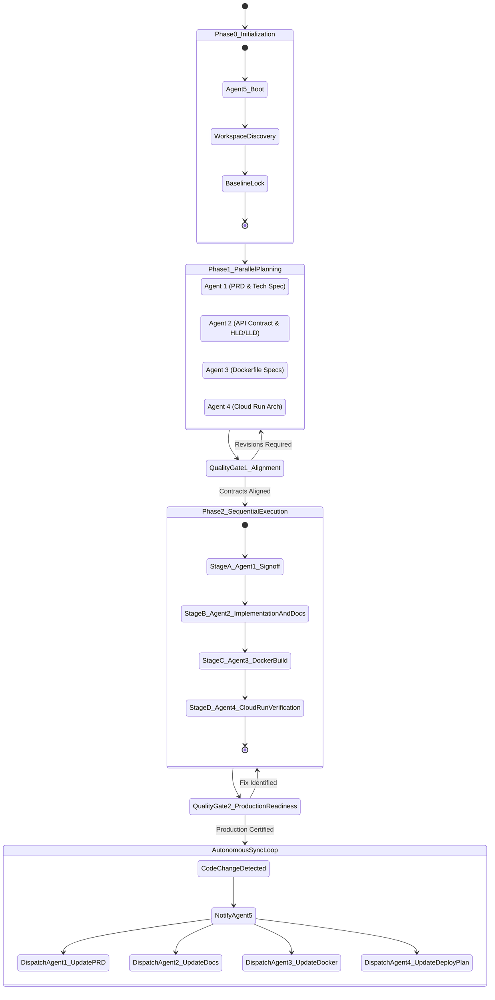

# 🤖 Antigravity Multi-Agentic Microservices Engineering Framework (Python / Flask)

Welcome to the **Antigravity Multi-Agentic Framework** for enterprise-grade Python microservice ecosystems built on **Python 3.15.2** and **Flask**. This framework establishes an autonomous, role-specialized team of 5 expert agents designed to specify, document, implement, containerize, and deploy production-grade microservices to Google Cloud Run, adhering to modern enterprise engineering and banking standards.

---

## 👥 The Multi-Agent Expert Roster

| Agent | Role | Expertise Level | Core Responsibility & Sync Domain |
| :--- | :--- | :--- | :--- |
| **[Agent 1: Requirements & Architecture Spec](AGENT1_REQUIREMENTS_SPEC.md)** | Principal Cloud & Systems Architect | 15+ Years Enterprise Microservices | Authors and maintains exhaustive PRDs, domain boundaries, functional/non-functional requirements, and Python 3.15.2/Flask technical stack specifications. Continuous monitoring and two-way sync with implementation and infra changes. |
| **[Agent 2: Design, Docs & Implementation](AGENT2_DESIGN_DOCS_DEV.md)** | Staff Engineer & Lead Technical Writer | Industry Standard Documentation & Python/Flask Engineering | Creates rich, modern, iconic, Mermaid-based HLD, LLD, and Sequence diagrams in `README.md`. Implements endpoints, centralized exception handling (`@app.errorhandler`), JSON structured logging with PII masking, latency interceptors, correlation traceability, circuit-breaker resiliency, S3/local CSV rate ingestion, and health actuators. Keeps docs in permanent sync with code. |
| **[Agent 3: Docker & Containerization](AGENT3_DOCKER_CONTAINERIZATION.md)** | Principal Platform & DevOps Engineer | Container Security, Multi-Stage Builds, OCI Standards | Crafts production-hardened, non-root multi-stage Dockerfiles optimized for Python 3.15.2, builds images, generates Docker Compose environments, manages Docker Hub / Google Artifact Registry pushes, and syncs container configurations with code changes. |
| **[Agent 4: Google Cloud Run & SRE](AGENT4_GCLOUD_RUN_DEPLOYMENT.md)** | Staff SRE & GCP Cloud Architect | Serverless Container Platforms & Zero-Trust Cloud Architecture | Authors step-by-step Google Cloud Run deployment plans, IAM service-to-service authentication (OIDC tokens), Secret Manager integration, S3/GCS bucket connectivity, autoscaling rules, health probes, and CI/CD pipelines. Syncs with service contracts and container specs. |
| **[Agent 5: Master Orchestrator](AGENTS_ORCHESTRATOR.md)** | Chief Engineering Orchestrator (Master Agent) | Distributed Workflow & Autonomous Agent Coordination | Master orchestrator governing parallel and sequential execution, event-driven state transitions, dependency handoffs, quality gates, automated conflict resolution, and synchronization across Agents 1 to 4. |

---

## 🏛️ Target Business Domain & Microservices Architecture

The platform delivers a resilient, high-performance financial currency processing ecosystem composed of two core microservices:

1. **`currency-exchange-service-python`** (Port: `8000`):
   - **Authority on Currency Exchange Rates**: Provides real-time and historical conversion multiples between currency pairs (e.g., `USD` to `INR`, `EUR` to `GBP`).
   - **Data Ingestion Engine**: Loads and hot-reloads currency exchange rates from an S3 bucket or local Windows file path (`exchange_rates.csv`) at startup and on demand.
   - **Observability & Health**: Exposes Spring-like Actuators (`/health`, `/health/liveness`, `/health/readiness`, `/info`, `/metrics`).
   - **Structured Resilience**: Integrated JSON logging with PII masking, millisecond-precision request/response interceptors, and centralized error responses.

2. **`currency-conversion-service-python`** (Port: `8100`):
   - **Currency Conversion Calculation Engine**: Orchestrates conversion requests by accepting `fromCurrency`, `toCurrency`, and `quantity`.
   - **Inter-Service Communication**: Makes resilient HTTP calls to `currency-exchange-service-python` to fetch live rates.
   - **Fault Tolerance**: Implements circuit breaker, timeout limits, and exponential backoff retries for external service invocations.
   - **Calculation & Traceability**: Computes total calculated amount (`quantity * conversionMultiple`), appending environment runtime metadata, hop-by-hop correlation IDs (`X-Correlation-ID` / `X-Trace-ID`), and processing latency.

---

## 🔄 End-to-End Microservice Topology

```mermaid
flowchart TD
    Client(["🌐 Client / API Consumer"]) -->|HTTPS REST<br/>X-Correlation-ID| ConvSvc["💱 currency-conversion-service-python<br/>Port: 8100<br/>• Flask / Python 3.15.2<br/>• Latency Interceptor<br/>• JSON Logging + PII Masking<br/>• Resilient HTTP Client (Retry/Timeout)"]

    subgraph InternalNetwork ["🔒 Internal Service Mesh / Google Cloud Run VPC"]
        ConvSvc -->|GET /currency-exchange/from/{from}/to/{to}<br/>Propagates X-Correlation-ID| ExchSvc["📊 currency-exchange-service-python<br/>Port: 8000<br/>• Flask / Python 3.15.2<br/>• Centralized Exception Handling<br/>• CSV Rate Ingestion Engine<br/>• Health & Actuator Endpoints"]
    end

    subgraph StorageLayer ["💾 Rate Storage Authority"]
        S3Bucket[("☁️ AWS S3 / GCS Bucket<br/>s3://currency-rates/exchange_rates.csv")]
        LocalCSV[("📁 Local Windows Path<br/>C:\\rates\\exchange_rates.csv")]
    end

    ExchSvc -.->|Load on Startup / Sync| S3Bucket
    ExchSvc -.->|Fallback / Local Dev| LocalCSV

    subgraph Governance ["🤖 Multi-Agent Orchestration Engine"]
        Agent5["👑 Agent 5: Master Orchestrator"]
        Agent1["📝 Agent 1: Requirements"]
        Agent2["🎨 Agent 2: Design & Docs"]
        Agent3["🐳 Agent 3: Docker DevOps"]
        Agent4["☁️ Agent 4: Cloud Run SRE"]

        Agent5 <--> Agent1
        Agent5 <--> Agent2
        Agent5 <--> Agent3
        Agent5 <--> Agent4
    end
```

---

## 🔁 Multi-Agent Coordination Matrix: Parallel vs. Sequential Modes

The framework supports both **Independent Parallel Execution** and **Strict Sequential Coordination** through Agent 5's centralized Event Bus:



---

## 📂 Framework Directory Structure

```text
c:/Users/amsid/projects/python_projects/New folder/
├── .agents/
│   ├── README.md                                 # Master Framework Overview (This Document)
│   ├── AGENTS_ORCHESTRATOR.md                    # Agent 5 Playbook: State Machine & Sync Protocol
│   ├── AGENT1_REQUIREMENTS_SPEC.md               # Agent 1 Playbook: PRD & Architecture Specifications
│   ├── AGENT2_DESIGN_DOCS_DEV.md                 # Agent 2 Playbook: Design, Docs & Implementation Specs
│   ├── AGENT3_DOCKER_CONTAINERIZATION.md         # Agent 3 Playbook: Dockerfiles & Image Pipelines
│   ├── AGENT4_GCLOUD_RUN_DEPLOYMENT.md           # Agent 4 Playbook: Google Cloud Run Deployment Architecture
│   ├── workflows/
│   │   ├── 01_requirements_architecture_workflow.md
│   │   ├── 02_design_docs_implementation_workflow.md
│   │   ├── 03_docker_containerization_workflow.md
│   │   ├── 04_gcloud_run_deployment_workflow.md
│   │   └── 05_master_orchestration_workflow.md
│   ├── templates/
│   │   ├── exchange_rates_sample.csv             # Reference CSV currency rate matrix
│   │   ├── error_response_spec.json              # Standardized error response contract
│   │   └── agent_sync_event.json                 # Inter-agent event message schema
│   └── sync/
│       └── orchestrator_state.json               # Live state & coordination log
├── currency-conversion-service-python/           # Service 1: Currency Conversion
│   ├── app/
│   │   ├── __init__.py
│   │   ├── api/
│   │   ├── client/
│   │   ├── core/
│   │   ├── models/
│   │   └── utils/
│   ├── Dockerfile
│   ├── requirements.txt
│   └── README.md
├── currency-exchange-service-python/             # Service 2: Currency Exchange
│   ├── app/
│   │   ├── __init__.py
│   │   ├── api/
│   │   ├── core/
│   │   ├── data/
│   │   ├── models/
│   │   └── utils/
│   ├── data/
│   │   └── exchange_rates.csv
│   ├── Dockerfile
│   ├── requirements.txt
│   └── README.md
├── docker-compose.yml                            # Local dual-service orchestration
└── README.md                                     # Root Project Overview
```
