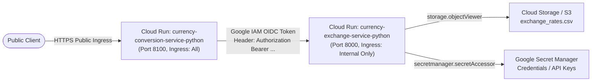

# 📋 Workflow 4: Google Cloud Run Deployment & Cloud Architecture

## 1. Overview & Objective
Governed by **Agent 4 (Cloud Run SRE & Cloud Architect)**. This workflow covers the end-to-end production deployment of both microservices to Google Cloud Run. It establishes zero-trust IAM authentication between services, Secret Manager bindings, Google Cloud Storage / S3 bucket connectivity for rate CSVs, autoscaling, and declarative infrastructure-as-code manifests.

---

## 2. Step-by-Step Execution Sequence

### Step 4.1: Cloud Architecture Blueprint


### Step 4.2: GCP Environment Initialization
1. Select/set GCP project and target compute region (`us-central1`).
2. Enable required service APIs:
   - `run.googleapis.com` (Cloud Run)
   - `artifactregistry.googleapis.com` (Artifact Registry)
   - `secretmanager.googleapis.com` (Secret Manager)
   - `storage.googleapis.com` (Cloud Storage)
   - `iam.googleapis.com` (IAM)

### Step 4.3: Identity & Access Management (IAM) Configuration
1. Create `sa-currency-exchange`:
   - Grant `roles/storage.objectViewer` on rate data bucket.
   - Grant `roles/secretmanager.secretAccessor` if using external secrets.
2. Create `sa-currency-conversion`:
   - Grant `roles/run.invoker` on the private `currency-exchange-service-python`.
3. Configure OIDC token generation in `currency-conversion-service-python`:
   - Fetch identity token from Google Metadata server:
     `http://metadata.google.internal/computeMetadata/v1/instance/service-accounts/default/identity?audience=<EXCHANGE_SERVICE_URL>`
   - Attach token to `Authorization: Bearer <token>` when calling exchange service.

### Step 4.4: Cloud Run Service Deployment
1. **Deploy Internal Exchange Service**:
   - Ingress: `--ingress=internal`
   - Authentication: `--no-allow-unauthenticated`
   - Memory: 512Mi, CPU: 1
   - Min instances: 1 (to eliminate cold starts for rate lookups)
   - Max instances: 10
   - Health probes: `/health/liveness` and `/health/readiness`
2. **Deploy Public Conversion Service**:
   - Ingress: `--ingress=all`
   - Authentication: `--allow-unauthenticated`
   - Set environment variable: `EXCHANGE_SERVICE_URL=<EXCHANGE_SERVICE_URL>`
   - Health probes: `/health/liveness` and `/health/readiness`

### Step 4.5: Declarative Knative/Cloud Run Manifest Validation
Validate YAML specifications:
- `currency-conversion-service-python.yaml`
- `currency-exchange-service-python.yaml`
Deploy via `gcloud run services replace`.

### Step 4.6: Verification & Smoke Testing
1. Test health probe endpoint on public conversion service.
2. Execute conversion calculation test:
   ```bash
   curl -i "https://currency-conversion-service-python-<hash>-uc.a.run.app/currency-conversion-service-python/currency-conversion/from/USD/to/INR/quantity/100"
   ```
3. Inspect Cloud Logging for JSON structured log traces containing matched `X-Correlation-ID`.
