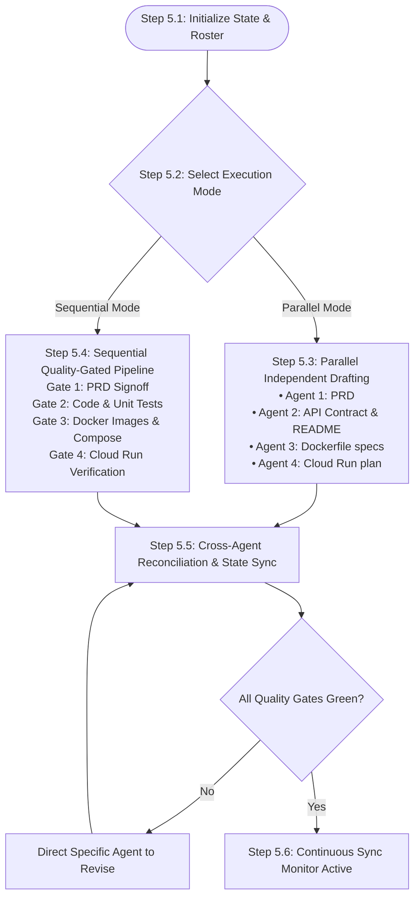

# 📋 Workflow 5: Master Orchestration & Inter-Agent Governance Workflow

## 1. Overview & Objective
Governed by **Agent 5 (Master Orchestrator)**. This workflow defines how the multi-agent system boots, switches between parallel and sequential coordination modes, manages state via `.agents/sync/orchestrator_state.json`, triggers quality gates, and conducts automatic two-way synchronization when code, docs, containers, or deployment plans change.

---

## 2. Multi-Agent Lifecycle & Coordination Engine

---

## 3. Step-by-Step Execution Sequence

### Step 5.1: System Initialization
1. Agent 5 verifies the availability of all 4 sub-agent personas and their playbook documents.
2. Initializes `.agents/sync/orchestrator_state.json` setting global status to `INITIALIZING`.
3. Validates host prerequisites:
   - Python 3.15.2 runtime.
   - Docker CLI & daemon responsiveness.
   - Cloud Run tooling & credentials readiness.

### Step 5.2: Parallel Mode vs. Sequential Mode Governance
- **Independent Parallel Mode**:
  - Activated during specification, research, documentation drafting, and independent unit testing.
  - Agents 1, 2, 3, and 4 work concurrently in non-interfering workspaces or branches.
- **Sequential Coordinated Mode**:
  - Activated during contract changes, inter-service API updates, integration testing, and production deployment execution.
  - Order: **Agent 1 (Specs) ➔ Agent 2 (Code & Docs) ➔ Agent 3 (Docker) ➔ Agent 4 (Cloud Run)**.

### Step 5.3: Event-Driven Synchronization Loop
Whenever a file event occurs:
1. Agent 5 intercepts the delta (e.g., Agent 2 adds a query parameter to `/currency-conversion`).
2. Evaluates downstream impact graph:
   - **Impact 1 (Agent 1)**: PRD documentation needs parameter schema addition.
   - **Impact 2 (Agent 3)**: Check if new environment variables or ports are introduced.
   - **Impact 3 (Agent 4)**: Check if Cloud Run request routing or timeout requires adjustment.
3. Broadcasts synchronization tasks to affected agents.
4. Waits for all agents to report `SYNC_ACK`.
5. Updates `orchestrator_state.json` to `SYNCHRONIZED`.

### Step 5.4: Health & Audit Tracking
- Agent 5 maintains a live audit log of all transitions, handoffs, and agent outputs in `.agents/sync/orchestrator_state.json`.
