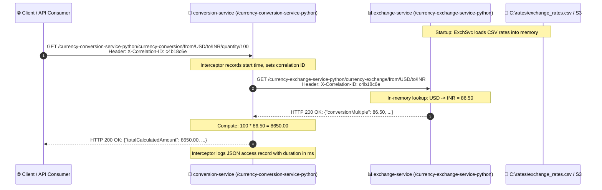

# 🌐 Python Microservices Ecosystem: Currency Management

[](https://www.python.org/)
[](https://flask.palletsprojects.com/)
[](#-microservices-overview--context-paths)
[](https://www.docker.com/)
[](https://cloud.google.com/run)
[](#-multi-agent-system-architecture)

A production-grade, financial microservices architecture implemented in **Python 3.15.2** and **Flask**, engineered and orchestrated by an autonomous **5-Agent Multi-Agentic Framework** with standardized **e2e layered architecture** and dedicated context paths.

---

## 📑 Table of Contents
1. [Overview](#-overview)
2. [Microservices Overview & Context Paths](#-microservices-overview--context-paths)
3. [Multi-Agent System Architecture](#-multi-agent-system-architecture)
4. [Standard Layered e2e Project Structure](#-standard-layered-e2e-project-structure)
5. [High-Level Architecture & End-to-End Flow](#-high-level-architecture--end-to-end-flow)
6. [Centralized Error Handling & Error Taxonomy](#-centralized-error-handling--error-taxonomy)
7. [Enterprise Standards Implemented](#-enterprise-standards-implemented)
8. [Local Quickstart & Execution](#-local-quickstart--execution)

---

## 🌟 Overview

The ecosystem provides resilient, observable foreign currency exchange rates and high-volume currency conversion calculations:
- **`currency-exchange-service-python`** (Port: `8000` | Context Path: `/currency-exchange-service-python`):
  Ingests exchange rates from an S3 bucket or local Windows file (`C:\rates\exchange_rates.csv`), manages in-memory rate stores, and provides rate lookups under its context path.
- **`currency-conversion-service-python`** (Port: `8100` | Context Path: `/currency-conversion-service-python`):
  Accepts currency pair and quantity, fetches live rates from the exchange service with retries and circuit breaking, computes total converted amounts, and propagates tracing headers.

---

## 🌐 Microservices Overview & Context Paths

All routes (business endpoints, actuator health probes, metrics, and Swagger UI) are strictly mounted under dedicated base context paths:

| Service | Port | Base Context Path | Swagger UI URL | Health Actuator |
| :--- | :--- | :--- | :--- | :--- |
| **Currency Exchange** | `8000` | `/currency-exchange-service-python` | `http://localhost:8000/currency-exchange-service-python/swagger` | `http://localhost:8000/currency-exchange-service-python/health` |
| **Currency Conversion** | `8100` | `/currency-conversion-service-python` | `http://localhost:8100/currency-conversion-service-python/swagger` | `http://localhost:8100/currency-conversion-service-python/health` |

---

## 🤖 Multi-Agent System Architecture

The project is governed by 5 specialized autonomous agents:

| Agent | Title | Core Expertise & Ownership |
| :--- | :--- | :--- |
| **[Agent 1](.agents/AGENT1_REQUIREMENTS_SPEC.md)** | **Requirements & Architecture Specialist** | PRD specifications, context path standards, error taxonomy (`CESP`/`CCSP`), domain boundaries. |
| **[Agent 2](.agents/AGENT2_DESIGN_DOCS_DEV.md)** | **Design, Documentation & Code Engine** | Standardized `e2e` layered implementation, `.env` & `constants.py` error handling, Mermaid READMEs. |
| **[Agent 3](.agents/AGENT3_DOCKER_CONTAINERIZATION.md)** | **DevOps & Containerization Specialist** | Multi-stage Dockerfiles with context path probes, non-root execution, Docker Compose orchestration. |
| **[Agent 4](.agents/AGENT4_GCLOUD_RUN_DEPLOYMENT.md)** | **Cloud Run SRE & Cloud Architect** | Step-by-step Google Cloud Run deployment, zero-trust IAM OIDC auth, declarative Knative YAML manifests. |
| **[Agent 5](.agents/AGENTS_ORCHESTRATOR.md)** | **Master Orchestrator** | Master orchestrator governing execution order, quality gates, synchronization, and directory structure. |

---

## 🏛️ Standard Layered e2e Project Structure

Both services share a standardized, highly modularized, enterprise-grade architecture:

```text
currency-management-python/
├── .agents/                                       # Multi-Agent Orchestration Hub
│   ├── README.md                                  # Multi-Agent Framework Master Overview
│   ├── AGENTS_ORCHESTRATOR.md                     # Agent 5: Master Orchestrator Playbook
│   ├── AGENT1_REQUIREMENTS_SPEC.md                # Agent 1: Requirements & Architecture Spec
│   ├── AGENT2_DESIGN_DOCS_DEV.md                  # Agent 2: Design, Docs & Dev Engine
│   ├── AGENT3_DOCKER_CONTAINERIZATION.md          # Agent 3: Docker & Containerization Spec
│   ├── AGENT4_GCLOUD_RUN_DEPLOYMENT.md            # Agent 4: Google Cloud Run SRE Spec
│   ├── workflows/                                 # Standardized Phase Workflows
│   └── sync/
│       └── orchestrator_state.json                # Live coordination state
├── currency-conversion-service-python/            # Microservice 1 (Port: 8100)
│   ├── .env                                       # Config & CCSP error messages
│   ├── app.py                                     # Main application runner
│   ├── constants.py                               # Central constants driven by .env
│   ├── requirements.txt                           # Dependencies
│   ├── Dockerfile                                 # Multi-stage container
│   ├── README.md                                  # Mermaid documentation
│   ├── tests/                                     # Automated test suite (7/7 passed)
│   └── e2e/                                       # Layered architecture package
│       ├── config/                                # Configuration loader
│       ├── modules/                               # ConversionResult domain model
│       ├── service/                               # ConversionService & resilient HTTP client
│       ├── exception/                             # CCSP custom exceptions & error handler
│       ├── utils/                                 # JSON logging & latency interceptor
│       └── route/                                 # Conversion, actuator & Swagger routes
├── currency-exchange-service-python/              # Microservice 2 (Port: 8000)
│   ├── .env                                       # Config & CESP error messages
│   ├── app.py                                     # Main application runner
│   ├── constants.py                               # Central constants driven by .env
│   ├── requirements.txt                           # Dependencies
│   ├── Dockerfile                                 # Multi-stage container
│   ├── README.md                                  # Mermaid documentation
│   ├── data/                                      # Rate dataset fallback
│   ├── tests/                                     # Automated test suite (8/8 passed)
│   └── e2e/                                       # Layered architecture package
│       ├── config/                                # Configuration loader
│       ├── modules/                               # ExchangeRate domain model
│       ├── service/                               # RateService in-memory & CSV loader
│       ├── exception/                             # CESP custom exceptions & error handler
│       ├── utils/                                 # JSON logging & latency interceptor
│       └── route/                                 # Exchange, actuator & Swagger routes
├── deploy/                                        # Cloud Deployment Runbooks & YAMLs
│   └── cloud-run/
├── docker-compose.yml                             # Local dual-service mesh
└── README.md                                      # Workspace Master Documentation
```

---

## 🏛️ High-Level Architecture & End-to-End Flow



---

## 🚨 Centralized Error Handling & Error Taxonomy

Both services return a unified error response template:
```json
{
  "timestamp": "2026-11-24T02:14:09.123456+00:00",
  "status": 404,
  "errorCode": "CESP_001",
  "errorMessage": "Exchange rate not available for the requested currency pair.",
  "errorDetailMessage": "Rate lookup for conversion pair 'USD' -> 'XYZ' returned null in repository.",
  "path": "/currency-exchange-service-python/currency-exchange/from/USD/to/XYZ",
  "correlationId": "cfe4b721-c753-4af7-94c2-01bf8cbaf334",
  "details": [
    "The requested currency conversion pair USD->XYZ is not maintained in the active rate store."
  ]
}
```

### Taxonomy:
- **Currency Exchange Service**: `CESP_001` (Rate Not Found), `CESP_002` (Invalid Currency), `CESP_003` (Data Ingestion Error), `CESP_500` (Internal Error).
- **Currency Conversion Service**: `CCSP_001` (Rate Not Found), `CCSP_002` (Invalid Quantity), `CCSP_003` (Invalid Currency), `CCSP_004` (Downstream Unavailable), `CCSP_500` (Internal Error).

---

## ⚡ Local Quickstart & Execution

### 1. Run Automated Unit Test Suites (15/15 Passed):
```powershell
# Exchange Service tests (8 passed)
cd "currency-exchange-service-python"; python -m pytest tests -v; cd ..

# Conversion Service tests (7 passed)
cd "currency-conversion-service-python"; python -m pytest tests -v; cd ..
```

### 2. Run with Docker Compose:
```powershell
docker compose up --build
```

### 3. Test Conversion API:
```powershell
curl -i "http://localhost:8100/currency-conversion-service-python/currency-conversion/from/USD/to/INR/quantity/100" -H "X-Correlation-ID: live-test-001"
```
