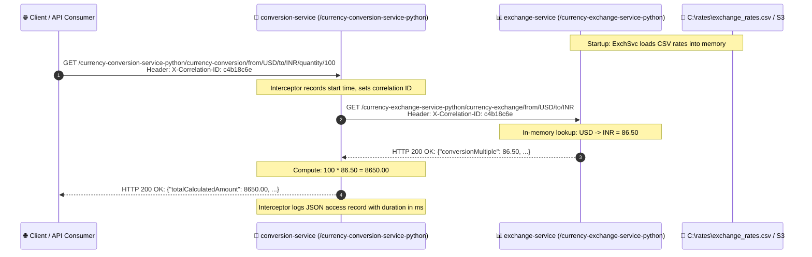

# 🌐 Python Microservices Ecosystem: Currency Management

[](https://www.python.org/)
[](https://flask.palletsprojects.com/)
[](#-microservices-overview--context-paths)
[](https://www.docker.com/)
[](https://cloud.google.com/run)
[](#-multi-agent-system-architecture)

A production-grade, financial microservices architecture implemented in **Python 3.15.2** and **Flask**, engineered and orchestrated by an autonomous **5-Agent Multi-Agentic Framework** with standardized **e2e layered architecture** and dedicated context paths.

---

## 📑 Table of Contents
1. [Overview](#-overview)
2. [Microservices Overview & Context Paths](#-microservices-overview--context-paths)
3. [Multi-Agent System Architecture](#-multi-agent-system-architecture)
4. [Standard Layered e2e Project Structure](#-standard-layered-e2e-project-structure)
5. [High-Level Architecture & End-to-End Flow](#-high-level-architecture--end-to-end-flow)
6. [Centralized Error Handling & Error Taxonomy](#-centralized-error-handling--error-taxonomy)
7. [Enterprise Standards Implemented](#-enterprise-standards-implemented)
8. [Local Quickstart & Dual Docker Execution](#-local-quickstart--dual-docker-execution)
   - [8.1 Automated Unit Tests](#1-run-automated-unit-test-suites-1515-passed)
   - [8.2 Dual Docker Compose Architecture](#2-dual-docker-compose-architecture)
   - [8.3 Automation via `build-and-push-docker.ps1`](#3-automation-via-build-and-push-dockerps1)
   - [8.4 Direct Docker Compose CLI Commands](#4-direct-docker-compose-cli-commands)
   - [8.5 Environment Variables Configuration](#5-environment-variables-configuration)
   - [8.6 Smoke Testing & Live API Verification](#6-smoke-testing--live-api-verification)

---

## 🌟 Overview

The ecosystem provides resilient, observable foreign currency exchange rates and high-volume currency conversion calculations:
- **`currency-exchange-service-python`** (Port: `8000` | Context Path: `/currency-exchange-service-python`):
  Ingests exchange rates from an S3 bucket or local Windows file (`C:\rates\exchange_rates.csv`), manages in-memory rate stores, and provides rate lookups under its context path.
- **`currency-conversion-service-python`** (Port: `8100` | Context Path: `/currency-conversion-service-python`):
  Accepts currency pair and quantity, fetches live rates from the exchange service with retries and circuit breaking, computes total converted amounts, and propagates tracing headers.

---

## 🌐 Microservices Overview & Context Paths

All routes (business endpoints, actuator health probes, metrics, and Swagger UI) are strictly mounted under dedicated base context paths:

| Service | Port | Base Context Path | Swagger UI URL | Health Actuator |
| :--- | :--- | :--- | :--- | :--- |
| **Currency Exchange** | `8000` | `/currency-exchange-service-python` | `http://localhost:8000/currency-exchange-service-python/swagger` | `http://localhost:8000/currency-exchange-service-python/health` |
| **Currency Conversion** | `8100` | `/currency-conversion-service-python` | `http://localhost:8100/currency-conversion-service-python/swagger` | `http://localhost:8100/currency-conversion-service-python/health` |

---

## 🤖 Multi-Agent System Architecture

The project is governed by 5 specialized autonomous agents:

| Agent | Title | Core Expertise & Ownership |
| :--- | :--- | :--- |
| **[Agent 1](.agents/AGENT1_REQUIREMENTS_SPEC.md)** | **Requirements & Architecture Specialist** | PRD specifications, context path standards, error taxonomy (`CESP`/`CCSP`), domain boundaries. |
| **[Agent 2](.agents/AGENT2_DESIGN_DOCS_DEV.md)** | **Design, Documentation & Code Engine** | Standardized `e2e` layered implementation, `.env` & `constants.py` error handling, Mermaid READMEs. |
| **[Agent 3](.agents/AGENT3_DOCKER_CONTAINERIZATION.md)** | **DevOps & Containerization Specialist** | Multi-stage Dockerfiles with context path probes, non-root execution, Docker Compose orchestration. |
| **[Agent 4](.agents/AGENT4_GCLOUD_RUN_DEPLOYMENT.md)** | **Cloud Run SRE & Cloud Architect** | Step-by-step Google Cloud Run deployment, zero-trust IAM OIDC auth, declarative Knative YAML manifests. |
| **[Agent 5](.agents/AGENTS_ORCHESTRATOR.md)** | **Master Orchestrator** | Master orchestrator governing execution order, quality gates, synchronization, and directory structure. |

---

## 🏛️ Standard Layered e2e Project Structure

Both services share a standardized, highly modularized, enterprise-grade architecture:

```text
currency-management-python/
├── .agents/                                       # Multi-Agent Orchestration Hub
│   ├── README.md                                  # Multi-Agent Framework Master Overview
│   ├── AGENTS_ORCHESTRATOR.md                     # Agent 5: Master Orchestrator Playbook
│   ├── AGENT1_REQUIREMENTS_SPEC.md                # Agent 1: Requirements & Architecture Spec
│   ├── AGENT2_DESIGN_DOCS_DEV.md                  # Agent 2: Design, Docs & Dev Engine
│   ├── AGENT3_DOCKER_CONTAINERIZATION.md          # Agent 3: Docker & Containerization Spec
│   ├── AGENT4_GCLOUD_RUN_DEPLOYMENT.md            # Agent 4: Google Cloud Run SRE Spec
│   ├── workflows/                                 # Standardized Phase Workflows
│   └── sync/
│       └── orchestrator_state.json                # Live coordination state
├── currency-conversion-service-python/            # Microservice 1 (Port: 8100)
│   ├── .env                                       # Config & CCSP error messages
│   ├── app.py                                     # Main application runner
│   ├── constants.py                               # Central constants driven by .env
│   ├── requirements.txt                           # Dependencies
│   ├── Dockerfile                                 # Multi-stage container
│   ├── README.md                                  # Mermaid documentation
│   ├── tests/                                     # Automated test suite (7/7 passed)
│   └── e2e/                                       # Layered architecture package
│       ├── config/                                # Configuration loader
│       ├── modules/                               # ConversionResult domain model
│       ├── service/                               # ConversionService & resilient HTTP client
│       ├── exception/                             # CCSP custom exceptions & error handler
│       ├── utils/                                 # JSON logging & latency interceptor
│       └── route/                                 # Conversion, actuator & Swagger routes
├── currency-exchange-service-python/              # Microservice 2 (Port: 8000)
│   ├── .env                                       # Config & CESP error messages
│   ├── app.py                                     # Main application runner
│   ├── constants.py                               # Central constants driven by .env
│   ├── requirements.txt                           # Dependencies
│   ├── Dockerfile                                 # Multi-stage container
│   ├── README.md                                  # Mermaid documentation
│   ├── data/                                      # Rate dataset fallback
│   ├── tests/                                     # Automated test suite (8/8 passed)
│   └── e2e/                                       # Layered architecture package
│       ├── config/                                # Configuration loader
│       ├── modules/                               # ExchangeRate domain model
│       ├── service/                               # RateService in-memory & CSV loader
│       ├── exception/                             # CESP custom exceptions & error handler
│       ├── utils/                                 # JSON logging & latency interceptor
│       └── route/                                 # Exchange, actuator & Swagger routes
├── deploy/                                        # Cloud Deployment Runbooks & YAMLs
│   └── cloud-run/                                 # Google Cloud Run Knative manifests & scripts
├── enterprise-core-python/                        # Shared Enterprise Starter Library (v1.0.0)
│   ├── pyproject.toml                             # Package definition & pinned security deps
│   ├── setup.py                                   # Setuptools build configuration
│   ├── enterprise_core/                           # Logging, Exception, Actuator, Swagger
│   └── tests/                                     # Automated test suite (9/9 passed)
├── build-and-push-docker.ps1                      # Multi-mode Docker build/push/pull automation script
├── docker-compose.build.yml                       # Local build with Git auth & Docker Hub push
├── docker-compose.pull.yml                        # Zero-build pull & run from Docker Hub
├── docker-compose.yml                             # Default local development compose mesh
└── README.md                                      # Workspace Master Documentation
```

---

## 🏛️ High-Level Architecture & End-to-End Flow



---

## 🚨 Centralized Error Handling & Error Taxonomy

Both services return a unified error response template:
```json
{
  "timestamp": "2026-11-24T02:14:09.123456+00:00",
  "status": 404,
  "errorCode": "CESP_001",
  "errorMessage": "Exchange rate not available for the requested currency pair.",
  "errorDetailMessage": "Rate lookup for conversion pair 'USD' -> 'XYZ' returned null in repository.",
  "path": "/currency-exchange-service-python/currency-exchange/from/USD/to/XYZ",
  "correlationId": "cfe4b721-c753-4af7-94c2-01bf8cbaf334",
  "details": [
    "The requested currency conversion pair USD->XYZ is not maintained in the active rate store."
  ]
}
```

### Taxonomy:
- **Currency Exchange Service**: `CESP_001` (Rate Not Found), `CESP_002` (Invalid Currency), `CESP_003` (Data Ingestion Error), `CESP_500` (Internal Error).
- **Currency Conversion Service**: `CCSP_001` (Rate Not Found), `CCSP_002` (Invalid Quantity), `CCSP_003` (Invalid Currency), `CCSP_004` (Downstream Unavailable), `CCSP_500` (Internal Error).

---

## ⚡ Local Quickstart & Dual Docker Execution

### 1. Run Automated Unit Test Suites (24/24 Passed):
```powershell
# 1. Enterprise Core Library unit tests (9 passed)
pytest enterprise-core-python/tests -v

# 2. Exchange Service unit tests (8 passed)
pytest currency-exchange-service-python/tests -v

# 3. Conversion Service unit tests (7 passed)
pytest currency-conversion-service-python/tests -v
```

---

### 2. Dual Docker Compose Architecture

The ecosystem provides two dedicated Docker Compose configurations to accommodate both active local development and zero-build verification:

```mermaid
flowchart LR
    subgraph BuildWorkflow ["Workflow A: Local Build & Push (docker-compose.build.yml)"]
        SrcCode["Source Code<br/>+ Dockerfile"] -->|build-arg: GITHUB_TOKEN| BuildImg["Docker Build"]
        BuildImg -->|Tag: ${DOCKER_USERNAME}/<svc>:latest| TagImg["Local Image Tag"]
        TagImg -->|docker compose push| DHubPush[("🐳 Docker Hub")]
        TagImg -->|docker compose up| DevMesh["🖥️ Docker Desktop Mesh"]
    end

    subgraph PullWorkflow ["Workflow B: Zero-Build Pull & Run (docker-compose.pull.yml)"]
        DHubPull[("🐳 Docker Hub")] -->|docker compose pull| PullImg["Pre-built Images"]
        PullImg -->|docker compose up| ProdMesh["🖥️ Docker Desktop Mesh"]
    end
```

#### A. Build Setup: `docker-compose.build.yml`
- **Purpose**: Builds microservice container images locally using multi-stage Dockerfiles.
- **Git Dependency Authentication**: Injects `GITHUB_TOKEN` / `READ_PACKAGES_TOKEN` as a build-argument so `pip` securely clones `enterprise-core-python` pinned to git tag `@v1.0.0` inside the build stage.
- **Tagging & Registry**: Images are tagged as `${DOCKER_USERNAME:-amsidhlokhande}/currency-exchange-service-python:latest` and `${DOCKER_USERNAME:-amsidhlokhande}/currency-conversion-service-python:latest`.
- **Push & Run**: Supports pushing to Docker Hub with `DOCKER_USERNAME` / `DOCKER_PASSWORD` and runs on Docker Desktop under the isolated `currency-mesh` bridge network.

#### B. Zero-Build Remote Setup: `docker-compose.pull.yml`
- **Purpose**: Instantly spins up the complete microservice mesh without local compilation, development dependencies, or build tools.
- **Pure Pull**: Zero `build:` directives; exclusively pulls certified images from Docker Hub (`${DOCKER_USERNAME}/<service>:latest`).
- **Target Audience**: QA teams, testers, and developers who need quick local verification against published Docker Hub artifacts.

---

### 3. Automation via `build-and-push-docker.ps1`

The root orchestrator script [`build-and-push-docker.ps1`](file:///C:/Users/amsid/projects/python_projects/currency-management-python/build-and-push-docker.ps1) standardizes all Docker workflows:

```powershell
# Mode 1 (Default): Build locally, push to Docker Hub, and run on Docker Desktop
.\build-and-push-docker.ps1 -Action BuildPushRun

# Mode 2: Zero-Build - Pull pre-built images from Docker Hub and run
.\build-and-push-docker.ps1 -Action PullAndRun

# Mode 3: Build local images only (no push, no run)
.\build-and-push-docker.ps1 -Action BuildOnly

# Mode 4: Build local images and push to Docker Hub (ideal for CI pipelines)
.\build-and-push-docker.ps1 -Action BuildAndPush

# Mode 5: Tear down running containers and network
.\build-and-push-docker.ps1 -Action Down
```

#### Optional Custom Parameters:
```powershell
# Specify a custom Docker Hub namespace and custom tag:
.\build-and-push-docker.ps1 -Action BuildPushRun -Registry "myorg" -Tag "v1.0.0"
```

---

### 4. Direct Docker Compose CLI Commands

For environments without PowerShell or developers preferring direct CLI commands:

```powershell
# Export environment variables
$env:DOCKER_USERNAME = "amsidhlokhande"
$env:READ_PACKAGES_TOKEN = "ghp_yourGithubToken"

# --------------------------------------------------------------------
# Workflow A: Local Build & Run
# --------------------------------------------------------------------
# 1. Build images from Dockerfiles
docker compose -f docker-compose.build.yml build

# 2. Push images to Docker Hub
docker compose -f docker-compose.build.yml push

# 3. Start containers in detached mode
docker compose -f docker-compose.build.yml up -d

# --------------------------------------------------------------------
# Workflow B: Zero-Build Remote Pull & Run
# --------------------------------------------------------------------
# 1. Pull pre-built images from Docker Hub
docker compose -f docker-compose.pull.yml pull

# 2. Start containers without local builds
docker compose -f docker-compose.pull.yml up -d

# --------------------------------------------------------------------
# Teardown
# --------------------------------------------------------------------
docker compose -f docker-compose.build.yml down
# or
docker compose -f docker-compose.pull.yml down
```

---

### 5. Environment Variables Configuration

| Environment Variable | Required For | Description |
| :--- | :--- | :--- |
| `DOCKER_USERNAME` | Pushing / Pulling from Docker Hub | Docker Hub account name or registry namespace (default: `amsidhlokhande`). |
| `DOCKER_PASSWORD` | Docker Hub Authentication | Docker Hub Personal Access Token (PAT) or password for automated login. |
| `READ_PACKAGES_TOKEN` | Local Image Building | GitHub Personal Access Token with `read:packages` / `repo` permissions to clone `enterprise-core-python`. |
| `GITHUB_TOKEN` | Local Image Building | Alternative token variable if `READ_PACKAGES_TOKEN` is not explicitly set. |

> [!TIP]
> On Windows PowerShell, set these in your session with `$env:DOCKER_USERNAME = "your_username"`, `$env:DOCKER_PASSWORD = "your_token"`, and `$env:READ_PACKAGES_TOKEN = "your_pat"`.

---

### 6. Smoke Testing & Live API Verification

Once containers are active on Docker Desktop, verify system health and cross-service communication:

```powershell
# 1. Exchange Service Liveness Probe
curl -i http://localhost:8000/currency-exchange-service-python/health/liveness

# 2. Exchange Service Swagger UI
# Open in browser: http://localhost:8000/currency-exchange-service-python/swagger

# 3. Direct Currency Pair Lookup
curl -i http://localhost:8000/currency-exchange-service-python/currency-exchange/from/USD/to/INR

# 4. Conversion Calculation (USD to INR for 100 units via conversion -> exchange service mesh call)
curl -i "http://localhost:8100/currency-conversion-service-python/currency-conversion/from/USD/to/INR/quantity/100" `
    -H "X-Correlation-ID: live-test-001"
```

#### Expected 200 OK Response:
```json
{
  "id": 1001,
  "fromCurrency": "USD",
  "toCurrency": "INR",
  "conversionMultiple": 86.50,
  "quantity": 100.0,
  "totalCalculatedAmount": 8650.00,
  "environment": "currency-conversion-service-python:8100",
  "exchangeServiceEnvironment": "currency-exchange-service-python:8000",
  "correlationId": "live-test-001"
}
```

