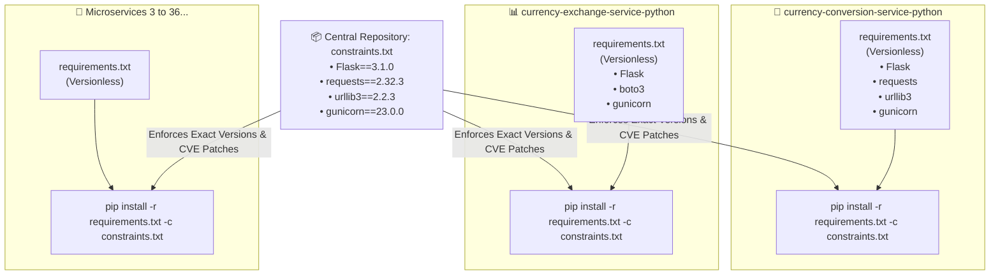

# 📦 Centralized Dependency Management (Python Microservices BOM)

> **Architectural Pattern**: Centralized Constraint Dependency Management  
> **Java / Maven Equivalence**: Parent `pom.xml` with `<dependencyManagement>` Bill of Materials (BOM)  
> **Target Problem**: Eliminating manual version updates across 36+ Python microservices when patching OSS vulnerabilities (CVEs).

---

## 💡 The Pain Point & Architectural Solution

### The Problem (36+ Microservices)
In enterprise Python architectures with dozens of microservices, each service traditionally maintains its own `requirements.txt` with hardcoded versions (`Flask==3.1.0`, `urllib3==2.2.1`, `requests==2.31.0`). When security scanners (Snyk, Prisma Cloud, Dependabot) flag a vulnerability:
1. Developers must submit and review **36 separate Pull Requests**.
2. Dependencies drift across services, leading to inconsistencies and untested version combinations.
3. Patching a single CVE requires dozens of hours of manual coordination and redeployment.

### The Solution: Centralized Constraints (`constraints.txt`)
In Java Spring Boot, you define versions centrally in a parent POM:
```xml
<!-- Maven Central POM / BOM -->
<dependencyManagement>
    <dependencies>
        <dependency>
            <groupId>org.springframework.boot</groupId>
            <artifactId>spring-boot-starter-web</artifactId>
            <version>3.2.0</version>
        </dependency>
    </dependencies>
</dependencyManagement>
```
And individual microservices declare only what they need **without version numbers**:
```xml
<!-- Child Service POM -->
<dependencies>
    <dependency>
        <groupId>org.springframework.boot</groupId>
        <artifactId>spring-boot-starter-web</artifactId>
        <!-- No version! Inherited from central BOM -->
    </dependency>
</dependencies>
```

In Python, **PIP Constraints Files (`-c constraints.txt`)** work identically:
1. **Central BOM (`central-dependency-management/constraints.txt`)**: Locks approved, security-vetted versions.
2. **Microservice `requirements.txt`**: Declares package names **without version pins**.
3. **Build Pipeline**: Enforces constraints via `pip install -r requirements.txt -c constraints.txt`.

---

## 🏛️ Architecture & End-to-End Workflow



---

## 🚀 How to Demo This to Your Manager

### Step 1: Show the Versionless `requirements.txt`
Show your manager that `currency-conversion-service-python/requirements.txt` and `currency-exchange-service-python/requirements.txt` contain **zero hardcoded version numbers**:
```text
Flask
requests
urllib3
python-json-logger
pytest
gunicorn
waitress
```

### Step 2: Show the Central Source of Truth
Show [central-dependency-management/constraints.txt](constraints.txt) where all 36+ services derive their exact approved versions.

### Step 3: Simulate a Live CVE Patching Event
1. **Scenario**: A security audit flags a critical vulnerability in `urllib3==2.2.3`.
2. **Old Way**: Edit 36 different `requirements.txt` files across 36 repos $\rightarrow$ 36 PRs.
3. **New Way**: 
   - Open `central-dependency-management/constraints.txt`.
   - Change `urllib3==2.2.3` to `urllib3==2.2.4` (or any patched version).
   - Commit once.
   - Run `.\build-and-push-docker.ps1`.
   - **Result**: Both services automatically build with the patched `urllib3` without touching a single line of microservice application code!
