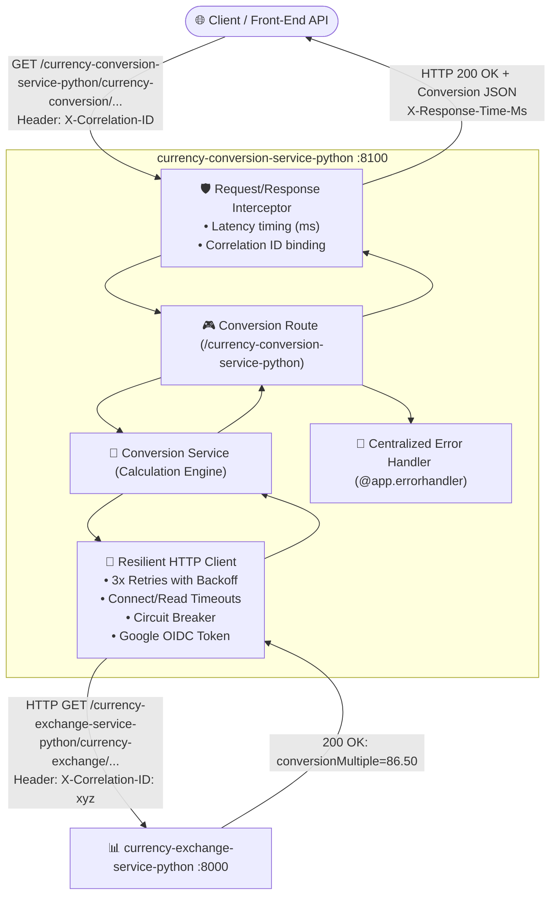
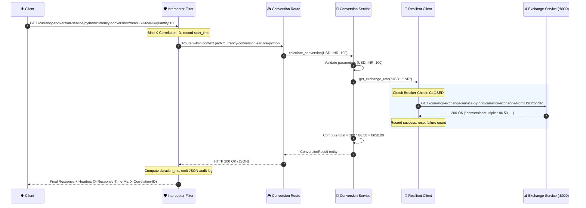

# 💱 Currency Conversion Service (Python / Flask)

[](https://www.python.org/)
[](https://flask.palletsprojects.com/)
[](#-context-path--api-endpoints-catalog)
[](https://www.docker.com/)
[](https://cloud.google.com/run)
[](#-swagger--openapi-documentation)

An enterprise-grade financial calculation microservice that orchestrates currency conversion calculations. Built with **Python 3.15.2** and **Flask**, engineered by the autonomous multi-agent framework following a standardized **e2e layered architecture**.

---

## 📑 Index
1. [Architecture Overview](#-architecture-overview)
2. [Project Layering & Directory Structure](#-project-layering--directory-structure)
3. [Context Path & API Endpoints Catalog](#-context-path--api-endpoints-catalog)
4. [High-Level Design (HLD)](#-high-level-design-hld)
5. [Low-Level Design (LLD) Sequence Diagram](#-low-level-design-lld-sequence-diagram)
6. [Resiliency & Fault Tolerance Patterns](#-resiliency--fault-tolerance-patterns)
7. [Centralized Exception Handling & CCSP Error Taxonomy](#-centralized-exception-handling--ccsp-error-taxonomy)
8. [JSON Structured Logging & PII Masking](#-json-structured-logging--pii-masking)
9. [Latency & Tracing Interceptors](#-latency--tracing-interceptors)
10. [Health & Actuator Probes](#-health--actuator-probes)
11. [Swagger & OpenAPI Documentation](#-swagger--openapi-documentation)
12. [Local Windows Setup & Quickstart](#-local-windows-setup--quickstart)
13. [Environment Configuration Reference (.env)](#-environment-configuration-reference-env)

---

## 🏛️ Architecture Overview

The `currency-conversion-service-python` accepts currency conversion orders (`fromCurrency`, `toCurrency`, `quantity`), delegating rate queries to `currency-exchange-service-python` under its context path.
- **Base Context Path**: All service endpoints, actuators, and Swagger documentation are mounted strictly under `/currency-conversion-service-python`.
- **Inter-Service Communication**: Queries `http://localhost:8000/currency-exchange-service-python/currency-exchange/from/{from}/to/{to}`.
- **Resilient Client**: Protected by 3x exponential backoff retries, timeouts, circuit breaker pattern, and Google IAM OIDC token support.

---

## 📂 Project Layering & Directory Structure

```text
currency-conversion-service-python/
├── .env                              # Environment configs & CCSP error messages
├── app.py                            # Flask application factory & WSGI runner
├── constants.py                      # Centralized constants driven by .env
├── requirements.txt                  # Python dependencies
├── Dockerfile                        # Multi-stage production container
├── README.md                         # Publication-grade documentation
├── tests/
│   ├── __init__.py
│   └── test_conversion_service.py    # Automated pytest suite (7/7 passing)
└── e2e/                              # End-to-End Enterprise Architecture
    ├── __init__.py
    ├── config/                       # Settings & environment integration
    │   ├── __init__.py
    │   └── settings.py
    ├── modules/                      # Domain models & DTOs
    │   ├── __init__.py
    │   └── conversion_result.py
    ├── service/                      # Business logic & resilient HTTP client
    │   ├── __init__.py
    │   ├── conversion_service.py
    │   └── exchange_client.py
    ├── exception/                    # Custom exceptions & centralized error handler
    │   ├── __init__.py
    │   ├── custom_exceptions.py
    │   └── error_handler.py
    ├── utils/                        # Structured JSON logger & interceptors
    │   ├── __init__.py
    │   ├── logging.py
    │   └── interceptors.py
    └── route/                        # Flask routes mounted under context path
        ├── __init__.py
        ├── conversion_routes.py
        ├── actuator_routes.py
        └── swagger_routes.py
```

---

## 📡 Context Path & API Endpoints Catalog

**Base Context Path**: `/currency-conversion-service-python`

| Method | Full Endpoint URI | Description | Status Codes |
| :--- | :--- | :--- | :--- |
| `GET` | `/currency-conversion-service-python/currency-conversion/from/{from}/to/{to}/quantity/{qty}` | Calculate currency conversion | `200 OK`, `400 Bad Request`, `404 Not Found`, `503 Unavailable` |
| `GET` | `/currency-conversion-service-python/health` | Comprehensive Actuator health status | `200 OK` |
| `GET` | `/currency-conversion-service-python/health/liveness` | Container liveness probe | `200 OK` |
| `GET` | `/currency-conversion-service-python/health/readiness` | Container readiness probe | `200 OK` |
| `GET` | `/currency-conversion-service-python/info` | Service metadata, runtime & uptime | `200 OK` |
| `GET` | `/currency-conversion-service-python/metrics` | Operational metrics | `200 OK` |
| `GET` | `/currency-conversion-service-python/swagger` | Interactive Swagger UI Web Documentation | `200 OK (HTML)` |
| `GET` | `/currency-conversion-service-python/openapi.json` | Declarative OpenAPI 3.0.3 specification | `200 OK (JSON)` |

#### Sample Success Response (`GET .../currency-conversion/from/USD/to/INR/quantity/100`):
```json
{
  "id": 1001,
  "fromCurrency": "USD",
  "toCurrency": "INR",
  "conversionMultiple": 86.50,
  "quantity": 100.0,
  "totalCalculatedAmount": 8650.00,
  "environment": "currency-conversion-service-python:8100",
  "exchangeServiceEnvironment": "currency-exchange-service-python:8000",
  "correlationId": "c4b18c6e-7ef1-4b71-9231-10c0e5a967c1",
  "timestamp": "2026-11-24T02:00:00.123456+00:00"
}
```

---

## 📐 High-Level Design (HLD)



---

## 🔄 Low-Level Design (LLD) Sequence Diagram



---

## 🚨 Centralized Exception Handling & CCSP Error Taxonomy

All exceptions are intercepted by a single point of error handling (`@app.errorhandler(Exception)`) in `e2e/exception/error_handler.py`.
- **`errorCode`**: Standardized with service prefix `CCSP_xxx`.
- **`errorMessage`**: Functional, user-friendly summary related to the business condition.
- **`errorDetailMessage`**: Detailed technical reason for debugging.
- **Driven by `.env`**: Mapped into constants in `constants.py`.

| Error Code | Functional Message | HTTP Status | Technical Condition |
| :--- | :--- | :--- | :--- |
| `CCSP_001` | Exchange rate not available for the requested currency pair. | `404 Not Found` | Downstream exchange service returned 404 |
| `CCSP_002` | Conversion quantity must be a positive numeric value greater than zero. | `400 Bad Request` | Quantity validation failed |
| `CCSP_003` | Currency code must be a valid 3-letter ISO 4217 alphabetic code. | `400 Bad Request` | Currency code regex validation failed |
| `CCSP_004` | The downstream Currency Exchange Service is currently unavailable. | `503 Unavailable` | Connection timeout or circuit breaker OPEN |
| `CCSP_500` | An internal processing error occurred in Currency Conversion Service. | `500 Server Error` | Unhandled runtime exception catch-all |

#### Unified Error Response Sample (`503 Service Unavailable`):
```json
{
  "timestamp": "2026-11-24T02:15:30.123456+00:00",
  "status": 503,
  "errorCode": "CCSP_004",
  "errorMessage": "The downstream Currency Exchange Service is currently unavailable.",
  "errorDetailMessage": "Failed to communicate with 'currency-exchange-service-python': Connection timed out",
  "path": "/currency-conversion-service-python/currency-conversion/from/USD/to/INR/quantity/100",
  "correlationId": "c4b18c6e-7ef1-4b71-9231-10c0e5a967c1",
  "details": [
    "Downstream dependency is either down, timed out, or circuit breaker is OPEN. Please retry shortly."
  ]
}
```

---

## 📖 Swagger & OpenAPI Documentation

- **Interactive UI**: Open `http://localhost:8100/currency-conversion-service-python/swagger`
- **Declarative Spec**: Access `http://localhost:8100/currency-conversion-service-python/openapi.json`

---

## 💻 Local Windows Setup & Quickstart

```powershell
# 1. Navigate to service directory
cd "currency-conversion-service-python"

# 2. Run automated tests (7/7 passing)
python -m pytest tests -v

# 3. Launch service on Port 8100
python app.py
```

Test endpoint:
```powershell
curl -i "http://localhost:8100/currency-conversion-service-python/currency-conversion/from/USD/to/INR/quantity/100" -H "X-Correlation-ID: local-conv-01"
```
