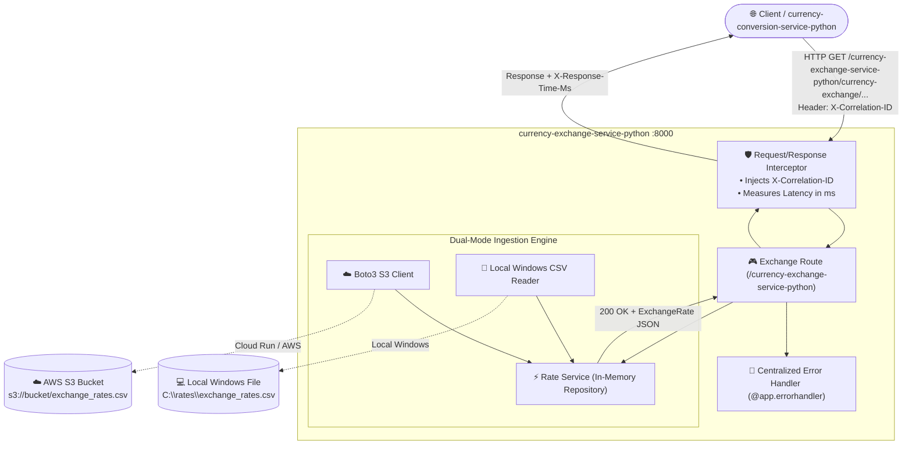
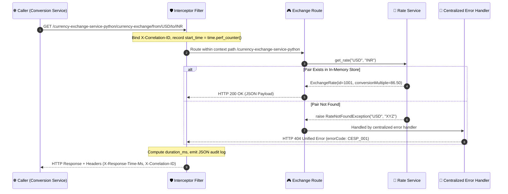

# 📊 Currency Exchange Service (Python / Flask)

[](https://www.python.org/)
[](https://flask.palletsprojects.com/)
[](#-context-path--api-endpoints-catalog)
[](https://www.docker.com/)
[](https://cloud.google.com/run)
[](#-swagger--openapi-documentation)

An enterprise-grade financial microservice providing authoritative foreign exchange rates. Built with **Python 3.15.2** and **Flask**, engineered by the autonomous multi-agent framework following a standardized **e2e layered architecture**.

---

## 📑 Index
1. [Architecture Overview](#-architecture-overview)
2. [Project Layering & Directory Structure](#-project-layering--directory-structure)
3. [Context Path & API Endpoints Catalog](#-context-path--api-endpoints-catalog)
4. [High-Level Design (HLD)](#-high-level-design-hld)
5. [Low-Level Design (LLD) Sequence Diagram](#-low-level-design-lld-sequence-diagram)
6. [Centralized Exception Handling & CESP Error Taxonomy](#-centralized-exception-handling--cesp-error-taxonomy)
7. [Dual-Mode Rate Ingestion (S3 vs Local Windows)](#-dual-mode-rate-ingestion-s3-vs-local-windows)
8. [JSON Structured Logging & PII Masking](#-json-structured-logging--pii-masking)
9. [Latency & Tracing Interceptors](#-latency--tracing-interceptors)
10. [Health & Actuator Probes](#-health--actuator-probes)
11. [Swagger & OpenAPI Documentation](#-swagger--openapi-documentation)
12. [Local Windows Setup & Quickstart](#-local-windows-setup--quickstart)
13. [Environment Configuration Reference (.env)](#-environment-configuration-reference-env)

---

## 🏛️ Architecture Overview

The `currency-exchange-service-python` serves as the single source of truth for foreign currency exchange rates.
- **Base Context Path**: All service endpoints, actuators, and Swagger documentation are mounted strictly under `/currency-exchange-service-python`.
- **Dual-Mode Data Ingestion**:
  - **Local Windows Machine**: Loads from `C:\rates\exchange_rates.csv` (fallback `data/exchange_rates.csv`).
  - **Cloud Run / Production**: Streams dynamically from AWS S3 (`s3://...`) using `boto3`.
- **In-Memory Cache**: Thread-safe memory hash map supporting sub-millisecond rate lookups and live hot-reloads via `POST /currency-exchange-service-python/currency-exchange/reload`.

---

## 📂 Project Layering & Directory Structure

```text
currency-exchange-service-python/
├── .env                              # Environment configs & CESP error messages
├── app.py                            # Flask application factory & WSGI runner
├── constants.py                      # Centralized constants driven by .env
├── requirements.txt                  # Python dependencies
├── Dockerfile                        # Multi-stage production container
├── README.md                         # Publication-grade documentation
├── data/
│   └── exchange_rates.csv            # Bundled fallback rate dataset
├── tests/
│   ├── __init__.py
│   └── test_exchange_service.py      # Automated pytest suite (8/8 passing)
└── e2e/                              # End-to-End Enterprise Architecture
    ├── __init__.py
    ├── config/                       # Settings & environment integration
    │   ├── __init__.py
    │   └── settings.py
    ├── modules/                      # Domain models & DTOs
    │   ├── __init__.py
    │   └── exchange_rate.py
    ├── service/                      # Core business logic & rate engine
    │   ├── __init__.py
    │   └── rate_service.py
    ├── exception/                    # Custom exceptions & centralized error handler
    │   ├── __init__.py
    │   ├── custom_exceptions.py
    │   └── error_handler.py
    ├── utils/                        # Structured JSON logger & interceptors
    │   ├── __init__.py
    │   ├── logging.py
    │   └── interceptors.py
    └── route/                        # Flask routes mounted under context path
        ├── __init__.py
        ├── exchange_routes.py
        ├── actuator_routes.py
        └── swagger_routes.py
```

---

## 📡 Context Path & API Endpoints Catalog

**Base Context Path**: `/currency-exchange-service-python`

| Method | Full Endpoint URI | Description | Status Codes |
| :--- | :--- | :--- | :--- |
| `GET` | `/currency-exchange-service-python/currency-exchange/from/{from}/to/{to}` | Retrieve live exchange rate for currency pair | `200 OK`, `400 Bad Request`, `404 Not Found` |
| `GET` | `/currency-exchange-service-python/currency-exchange/rates` | List all available currency rates in catalog | `200 OK` |
| `POST` | `/currency-exchange-service-python/currency-exchange/reload` | Hot reload rates from S3 or local CSV file | `200 OK` |
| `GET` | `/currency-exchange-service-python/health` | Comprehensive Actuator health status | `200 OK` / `503 Degraded` |
| `GET` | `/currency-exchange-service-python/health/liveness` | Container liveness probe | `200 OK` |
| `GET` | `/currency-exchange-service-python/health/readiness` | Readiness probe (verifies rate data loaded) | `200 OK` / `503 Out of Service` |
| `GET` | `/currency-exchange-service-python/info` | Service metadata, runtime & uptime | `200 OK` |
| `GET` | `/currency-exchange-service-python/metrics` | Operational metrics & pair counters | `200 OK` |
| `GET` | `/currency-exchange-service-python/swagger` | Interactive Swagger UI Web Documentation | `200 OK (HTML)` |
| `GET` | `/currency-exchange-service-python/openapi.json` | Declarative OpenAPI 3.0.3 specification | `200 OK (JSON)` |

#### Sample Success Response (`GET .../currency-exchange/from/USD/to/INR`):
```json
{
  "id": 1001,
  "fromCurrency": "USD",
  "toCurrency": "INR",
  "conversionMultiple": 86.50,
  "environment": "currency-exchange-service-python:8000",
  "lastUpdated": "2026-11-24T02:00:00.123456+00:00"
}
```

---

## 📐 High-Level Design (HLD)



---

## 🔄 Low-Level Design (LLD) Sequence Diagram



---

## 🚨 Centralized Exception Handling & CESP Error Taxonomy

All exceptions are intercepted by a single point of error handling (`@app.errorhandler(Exception)`) in `e2e/exception/error_handler.py`.
- **`errorCode`**: Standardized with service prefix `CESP_xxx`.
- **`errorMessage`**: Functional, user-friendly summary related to the business condition.
- **`errorDetailMessage`**: Detailed technical reason for debugging.
- **Driven by `.env`**: Mapped into constants in `constants.py`.

| Error Code | Functional Message | HTTP Status | Technical Condition |
| :--- | :--- | :--- | :--- |
| `CESP_001` | Exchange rate not available for the requested currency pair. | `404 Not Found` | Currency pair lookup in memory store returned null |
| `CESP_002` | Currency code must be a valid 3-letter ISO 4217 alphabetic code. | `400 Bad Request` | Input failed regex `^[A-Z]{3}$` validation |
| `CESP_003` | Unable to load currency exchange rate dataset from configured source. | `500 Server Error` | File read failure from S3 or local CSV path |
| `CESP_500` | An internal processing error occurred in Currency Exchange Service. | `500 Server Error` | Unhandled runtime exception catch-all |

#### Unified Error Response Sample (`404 Not Found`):
```json
{
  "timestamp": "2026-11-24T02:14:09.123456+00:00",
  "status": 404,
  "errorCode": "CESP_001",
  "errorMessage": "Exchange rate not available for the requested currency pair.",
  "errorDetailMessage": "Rate lookup for conversion pair 'USD' -> 'XYZ' returned null in repository.",
  "path": "/currency-exchange-service-python/currency-exchange/from/USD/to/XYZ",
  "correlationId": "cfe4b721-c753-4af7-94c2-01bf8cbaf334",
  "details": [
    "The requested currency conversion pair USD->XYZ is not maintained in the active rate store."
  ]
}
```

---

## 💾 Dual-Mode Rate Ingestion (S3 vs Local Windows)

The ingestion engine checks the `RATES_CSV_PATH` variable:
1. **Local Windows Machine**:
   - Path: `C:\rates\exchange_rates.csv`
   - Read using Python's standard `csv.DictReader`.
2. **Google Cloud Run / AWS Container**:
   - Path: `s3://currency-rates-bucket/exchange_rates.csv`
   - Dynamically streamed via `boto3.client('s3')`.
3. **Bundled Fallback**:
   - If configured path is absent, safely falls back to `data/exchange_rates.csv`.

---

## 📖 Swagger & OpenAPI Documentation

- **Interactive UI**: Open `http://localhost:8000/currency-exchange-service-python/swagger`
- **Declarative Spec**: Access `http://localhost:8000/currency-exchange-service-python/openapi.json`

---

## 💻 Local Windows Setup & Quickstart

```powershell
# 1. Navigate to service directory
cd "currency-exchange-service-python"

# 2. Run automated tests (8/8 passing)
python -m pytest tests -v

# 3. Launch service on Port 8000
python app.py
```

Test endpoint:
```powershell
curl -i "http://localhost:8000/currency-exchange-service-python/currency-exchange/from/USD/to/INR" -H "X-Correlation-ID: local-test-01"
```
