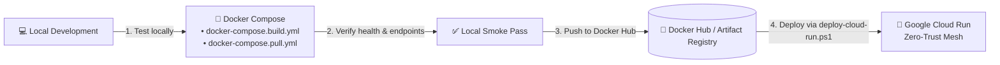

# 🚀 Google Cloud Run Production Deployment Guide

[](https://cloud.google.com/run)
[](#-zero-trust-service-to-service-authentication)
[](#-context-paths)

This production deployment guide was authored by **Agent 4 (Cloud Run SRE & Cloud Architect)**. It details the zero-trust deployment of both microservices to Google Cloud Run with IAM service-to-service authentication and strict context path routing.

---

## 📑 Index
1. [Context Paths](#-context-paths)
2. [Cloud Architecture & Topology](#-cloud-architecture--topology)
3. [Zero-Trust Service-to-Service Authentication](#-zero-trust-service-to-service-authentication)
4. [Container Build Pipelines & Local Parity (Docker Compose)](#-container-build-pipelines--local-parity-docker-compose)
5. [Prerequisites & CLI Setup](#-prerequisites--cli-setup)
6. [Automated Deployment (PowerShell / Bash)](#-automated-deployment-powershell--bash)
7. [Declarative YAML Manifests](#-declarative-yaml-manifests)
8. [Post-Deployment Verification & Smoke Tests](#-post-deployment-verification--smoke-tests)
9. [Observability & Cloud Monitoring](#-observability--cloud-monitoring)

---

## 🌐 Context Paths

Both microservices strictly isolate all business logic, actuators, and Swagger documentation under base context paths:
- **`currency-exchange-service-python`**: `/currency-exchange-service-python`
- **`currency-conversion-service-python`**: `/currency-conversion-service-python`

---

## 🏛️ Cloud Architecture & Topology

```mermaid
graph TB
    Client([🌐 Public API Client]) -->|HTTPS Request<br/>X-Correlation-ID| ConvRun["🚀 Cloud Run: currency-conversion-service-python<br/>• Ingress: all (Public)<br/>• Port: 8100<br/>• Context Path: /currency-conversion-service-python<br/>• SA: sa-currency-conversion"]

    subgraph GCP_Project ["Google Cloud Project: currency-microservices-prod"]
        ConvRun -->|1. Fetch OIDC Identity Token| MetadataServer["🔑 GCP Metadata Server<br/>http://metadata.google.internal/..."]
        MetadataServer -->>|2. Bearer <ID_TOKEN>| ConvRun

        ConvRun -->|3. Authenticated HTTPS Request<br/>Authorization: Bearer <ID_TOKEN><br/>Path: /currency-exchange-service-python/currency-exchange/...| ExchRun["🚀 Cloud Run: currency-exchange-service-python<br/>• Ingress: internal (Private)<br/>• Port: 8000<br/>• Context Path: /currency-exchange-service-python<br/>• SA: sa-currency-exchange"]

        ExchRun -->|4. Ingest CSV at boot| S3Bucket[("☁️ AWS S3 / Cloud Storage<br/>s3://currency-rates-bucket/exchange_rates.csv")]
    end

    ExchRun -->>|200 OK + Rate JSON| ConvRun
    ConvRun -->>|200 OK + Calculated Total JSON| Client
```

---

## 🐳 Container Build Pipelines & Local Parity (Docker Compose)

Before deploying to Google Cloud Run, microservices are containerized and validated locally on Docker Desktop using the dual Docker Compose architecture. Both local Docker builds and Cloud Run deployments share the exact same multi-stage Dockerfiles and Git-based library distribution model:



### 1. Dual Docker Compose Configurations:
- **`docker-compose.build.yml`**: Compiles images locally using the multi-stage Dockerfiles, securely passing `GITHUB_TOKEN` / `READ_PACKAGES_TOKEN` build-arguments so `pip` installs `enterprise-core-python` pinned to git tag `@v1.0.0`. Tags images as `${DOCKER_USERNAME}/<service>:latest` and runs them on Docker Desktop.
- **`docker-compose.pull.yml`**: Zero-build file that exclusively pulls pre-built images from Docker Hub (`${DOCKER_USERNAME}/<service>:latest`) and runs them directly on Docker Desktop with zero local compilation overhead.

### 2. Pre-Deployment Orchestration (`build-and-push-docker.ps1`):
```powershell
# Build locally, push to Docker Hub, and test on Docker Desktop:
.\build-and-push-docker.ps1 -Action BuildPushRun

# Or pull pre-built images for immediate validation:
.\build-and-push-docker.ps1 -Action PullAndRun
```

> [!NOTE]
> The same hardened, non-root (UID `10001`) container images verified via `docker-compose.build.yml` are pushed to Google Artifact Registry during Cloud Run deployment.

---

## ⚡ Automated Deployment (PowerShell / Bash)

### Windows PowerShell:
```powershell
.\deploy\cloud-run\deploy-cloud-run.ps1 `
    -ProjectId "currency-microservices-prod" `
    -Region "us-central1" `
    -S3RateUri "s3://currency-rates-bucket/exchange_rates.csv" `
    -GithubToken $env:READ_PACKAGES_TOKEN
```

### Linux / Google Cloud Shell (Bash):
```bash
chmod +x ./deploy/cloud-run/deploy-cloud-run.sh
./deploy/cloud-run/deploy-cloud-run.sh currency-microservices-prod us-central1 currency-repo latest s3://currency-rates-bucket/exchange_rates.csv "${GITHUB_TOKEN:-}"
```

---

## 🧪 Post-Deployment Verification & Smoke Tests

```powershell
# 1. Retrieve the public Conversion Service URL
$BASE_URL = (gcloud run services describe currency-conversion-service-python --region=us-central1 --format="value(status.url)")
$CONTEXT_URL = "$BASE_URL/currency-conversion-service-python"

# 2. Test Actuator Health under Context Path
curl -i "$CONTEXT_URL/health"

# 3. Test Conversion Calculation (USD to INR for 100 units)
curl -i "$CONTEXT_URL/currency-conversion/from/USD/to/INR/quantity/100" -H "X-Correlation-ID: smoke-test-001"
```

Expected Response:
```json
{
  "id": 1001,
  "fromCurrency": "USD",
  "toCurrency": "INR",
  "conversionMultiple": 86.50,
  "quantity": 100.0,
  "totalCalculatedAmount": 8650.00,
  "environment": "currency-conversion-service-python:8100",
  "exchangeServiceEnvironment": "currency-exchange-service-python:8000",
  "correlationId": "smoke-test-001"
}
```
